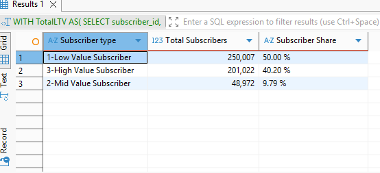
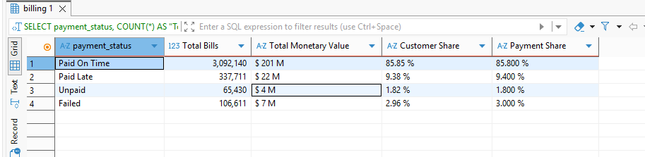
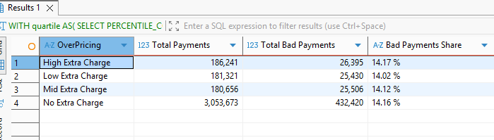
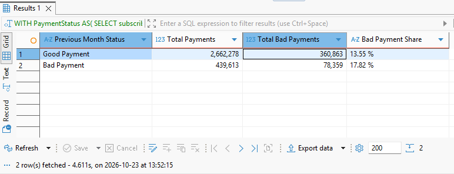
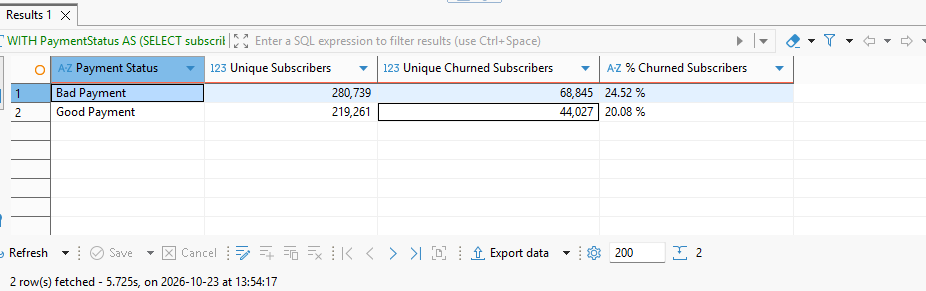
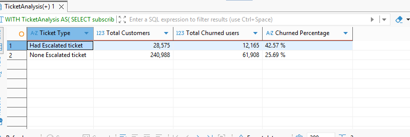
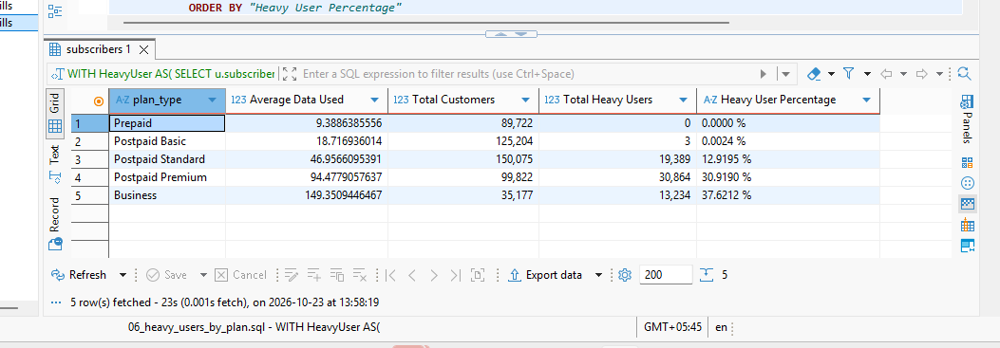

# **Telecom Billing & Churn Analysis**

Which telecom customers pay their bills badly or leave the company, and what can the company do about it?

## **Introduction**

The dataset used for this analysis is from Kaggle [ Source data ](https://www.kaggle.com/datasets/sergionefedov/telecom-500k-subscribers-with-usage-logs) . The data was cleaned, transformed and loaded into a PostgreSQL database, where all the analysis was done with help of SQL (DBeaver). It covers about 500,000 subscribers from 2025-07 to 2026-05. For uploading globally I used VSCode where I wrote further README files.

**Tools:** PostgreSQL, DBeaver, Excel(charts),VSCode
**SQL skills used:** CTEs, window functions (`LAG`), `FILTER`, `BOOL_OR`, `PERCENTILE_CONT`, multi-table joins, customer-level aggregation

## **Key Findings**

- 14.15% of the bills are paid badly. Unpaid and failed bills accounts which are at risk only  4.8% of total  bills, but they are worth about $11 M.
- Extra charges like overage and romaing  doesnot causes bad payments. The bad payment rate is about 14% in each charge ranges.
- A bad payment in last month increases  the chance of another bad payment which  17.82% bad payment  vs 13.55% in case of previous month is good payment
- Customers with an escalated support ticket churn the most: which is almost 43% compared to  25.69% for no support tickets.
- Heavy data users are mostly avilable on  the expensive plans like   Business with  37.62% and Premium with  30.91%, while Basic and Prepaid have almost zero heavy users

## **Tables**

| [billing.csv](https://drive.google.com/file/d/1mIDRmPqZLYjvcyuS32BkQTObJpbSpIEC/view?usp=sharing) | Monthly bills, charges, payment status |
| [support_tickets.csv](https://drive.google.com/file/d/13RbDkz5y6JJMJ9jp1EAMttax6gzQJ9Gh/view?usp=sharing) | Support tickets, issue type, escalated or not |
| [subscriber.csv](https://drive.google.com/file/d/1jagUZgF9_okRTMf5x6pZ3o7edse2I_yH/view?usp=sharing) | Subscriber profile, plan type, monthly charge |
| [churn_labels.csv](https://drive.google.com/file/d/1dcsV8-PYyK8QGFrfg1O6qMN1Eop8EUfJ/view?usp=drive_link) | Whether a subscriber churned, date and reason |
| [usage_logs.csv](https://drive.google.com/file/d/1xy2O7oEPRRCyTnBTJYfqwYEdgnSmwlva/view?usp=sharing) | Monthly data, voice, SMS and roaming usage |

`subscriber_id` is the primary key of the subscribers table and links all the other tables. `billing` and `usage_logs` are also linked by the composite key  of `subscriber_id` + `year_month`.

## **Key Definitions**

**Good Payment:** a bill that is paid on time.

**Bad Payment:** a bill that is not paid on time. It includes failed, unpaid and paid late bills.

**Escalated Ticket:**  A user with suport ticket reports the problem but the lower level employee cannot solve it and the issue is passed to the higher level employee.

**Extra Charge:**  Sum of `data_overage_usd,intl_roaming_usd`. Extra charges are divided into Low, Mid and High by the 33rd and 66th percentile of the non-zero charges.

**Heavy User:** a subscriber whose average monthly data usage is at least 2 times the average of all subscribers for that specific category service.

**Subscriber Type:** based on lifetime value (LTV) after tax. High Value is above the average LTV, Mid Value is between the median and the average, and Low Value is at or below the median.

## **Analysis**

### **Query 0: Subscriber Type**
**SQL file:** [query_00_Subscribertype.sql](SqlScripts/query_00_Subscribertype.sql)

**Question:**
What is the share of low, mid and high value subscribers in the total subscriber count?
**graph** 




**Finding:**
Low Value Subscribers hold the largest share. Almost 1 in 2 subscribers is a Low Value Subscriber (50.00%), followed by High Value at 40.20% and Mid Value at 9.79%.

**Action:**
The company should focus on increasing revenue from the low value subscribers, as they are the majority. One option is cheaper data and calling plans. The margin per customer would be lower, but with such a large customer base the total revenue and profit could still rise a lot. High value customers can handle higher data rates, but good service quality matters for them. Mid value customers can be targeted with mid range prices.

### **Query 1: Payment Status of the Bills**
**SQL file:** [01_bad_payment_size.sql](SqlScripts/query_01_bad_payment_size.sql)

**Question:**
How are the bills divided by payment status, and what is the share and money value of each category?
**Visualization**




**Finding:**
Almost all of the bills are paid on time (85.85%), followed by paid late bills (9.38%), failed bills (2.96%) and unpaid bills (1.82%).

**Action:**
The real revenue risk is in the unpaid and failed bills. Together they are only account for about 4.8% of the total bills, but their combined monetory value is about $11 M, which is a significant amount. To recover them, the company can restrict incoming calls, send message reminders regularly and so on. Paid late bills still bring the money with extra revenue so automatic reminders are enough for them but they also can't be ignored completely as late revenue may halt in capital required for infrastructure upgrade, loan repayment etc.

### **Query 2: Extra Charges and Bad Payment**
**SQL file:** [02_extra_charges_vs_bad_payment.sql](SqlScripts/query_02_extra_charges_vs_bad_payment.sql)

**Question:**
Do bills with extra charges (divided into low, mid and high) have a higher bad payment percentage compared to the  bills with no extra charge?


Result:

**Finding:**
The bad payment percentage is almost the same in every category which is  around 14%, whether the extra charge is low, mid or high. So the extra charges have no any relation with the bad payment rate.

**Action:**
The company should not target reminders only on the basis of customers with overage or roaming charges, since it would not help. The reason for bad payments has to be found somewhere else, like the payment history of the customer which is further discussed in query 3.

### **Query 3: Previous Month Payment**

**SQL file:** [03_previous_month_bad_payment.sql](SqlScripts/query_03_previous_month_bad_payment.sql)

**Question:**
Does a good or bad payment in the previous month affects the bad payment rate of the next bill?

!



**Finding:**
After a good payment month, 13.55% of the bills are bad. After a bad payment month, 17.82% are bad. So a subscriber with a bad payment last month is almost about 1.3 times more likely to pay badly again.

**Action:**
Subscribers who had a bad payment in the previous month can be sent an alert message to pay on time, as they are more likely to pay badly. If a subscriber has bad payments in a row or very often, the company can think about applying extra fines or restric service access

*Note: each subscriber's first bill is left out because it has no previous month.*

### **Query 4: Bad Payment and Churn**
**SQL file:** [04_bad_payment_vs_churn.sql](SqlScripts/query_04_bad_payment_vs_churn.sql)

**Question:**
Do subscribers with at least one bad payment during the data period have a higher churn rate than subscribers who always paid on time?




**Finding:**
Subscribers with at least one bad payment have a churn rate about 1.2 times higher which is 24.52% compared to the subscribers who always paid on time which have around 20.08% churned rate.

**Action:**
A bad payment alone does not mean the money cannot be recovered, but high churn is dangerous for a healthy company. So the company should study why churn is higher among subscribers with a bad payment. One possible reason is that the frequent automated reminder messages irritate customers, but this is not tested in this analysis.

### **Query 5: Escalated Tickets and Churn**
**SQL file:** [05_escalated_ticket_vs_churn.sql](SqlScripts/query_05_escalated_ticket_vs_churn.sql)

**Question:**
Do subscribers with at least one escalated ticket have a higher churn rate than subscribers with no escalated ticket?
(Note: only subscribers who contacted the support team are taken into account.)


 

**Finding:**
Subscribers with at least one escalated ticket have a churn rate about 1.6 times higher which is 42.57% compared to the  subscribers who never had an escalated ticket which is 25.69%. This is the strongest churn link in the entire analysis.

**Action:**
The high churn of these subscribers may be because the issue was not solved properly by the higher level support, or because solving it took too long. The company should investigate this in more detail, for example with the resolution time and satisfaction columns, and give priority follow up to escalated customers.

### **Query 6: Heavy Users by Plan Type**
**SQL file:** [06_heavy_users_by_plan.sql](SqlScripts/query_06_heavy_users_by_plan.sql)

**Question:**
Does the plan type affect the percentage of heavy users?




**Finding:**
The plan type clearly affects the heavy user percentage. Business has the most heavy users (37.62%), followed by Postpaid Premium (30.92%) and Postpaid Standard (12.92%). Postpaid Basic (0.0024%) and Prepaid (0%) have almost zero heavy users. So the heavy users are mostly on the expensive plans.

**Action:**
Basic and Prepaid users rarely use heavy data, so data upgrade offers should not go to them. The Standard plan has about 19,000 heavy users, so they are the best group for an upgrade offer to Premium. For the low usage plans, an affordable data rate can encourage users to use more data, and even with a low margin the net revenue can grow.

*Note: my first version used each plan's own average as the cutoff, which forced every plan to about 15% heavy users and hid the real difference. Using one cutoff for all plans fixed it.*

## **Summary**

| # | Question | Result | Action |
|---|---|---|---|
| 0 | Subscriber type share | 50% Low, 40.2% High, 9.8% Mid | Grow revenue from Low Value users |
| 1 | Payment status | 14.15% bad, $11 M Failed + Unpaid | Focus recovery on Failed and Unpaid |
| 2 | Extra charges | About 14% in every band | Don't target reminders by charges |
| 3 | Previous month | 17.82% vs 13.55% | Alert after the first bad payment |
| 4 | Bad payment and churn | 24.52% vs 20.08% | Study why bad payers churn |
| 5 | Escalated ticket and churn | 42.57% vs 25.69% | Priority follow up on escalations |
| 6 | Heavy users by plan | Business 37.62%, Premium 30.92% | Upgrade offer to Standard heavy users |

## **Limitation**

- The dataset covers a short interval (2025-07 to 2026-05) and the month 2026-02 is missing. So it cannot be used for detailed analysis like revenue or churn rate per cohort year.
- The results show a link, not a cause. For example, a subscriber may pay badly or escalate a ticket after already deciding to leave.
- The data is artificial, so the insights may not represent the true characteristics of a real company.

## **Next Steps**

- Build a churn risk score using bad payments, escalated tickets and usage drop
- Check if the usage drops before a subscriber churns
- Build a Power BI dashboard

## **Repository Structure**

```
Telecom-Billing-Churn-Analysis/
├── README.md
├── DDL&dataload/
└── SqlScripts/
    ├── query_00_Subscribertype.sql
    ├── query_01_bad_payment_size.sql
    ├── query_02_extra_charges_vs_bad_payment.sql
    ├── query_03_previous_month_bad_payment.sql
    ├── query_04_bad_payment_vs_churn.sql
    ├── query_05_escalated_ticket_vs_churn.sql
    └── query_06_heavy_users_by_plan.sql
```

## **Author**
**AmitKarki** | [LinkedIn](www.linkedin.com/in/amit-karki-2447063bb
)| [Email Me](https://mail.google.com/mail/?view=cm&fs=1&to=your.iiswiikar@gmail.com&su=Hello)
